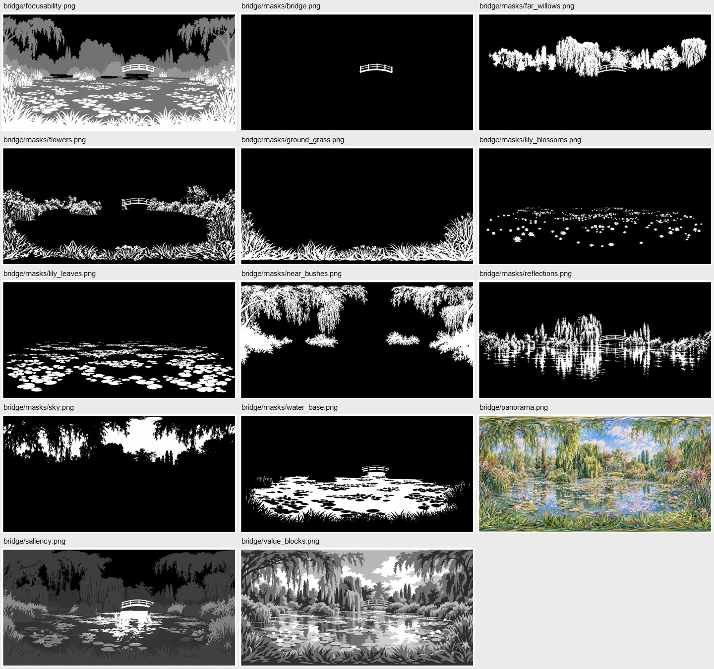
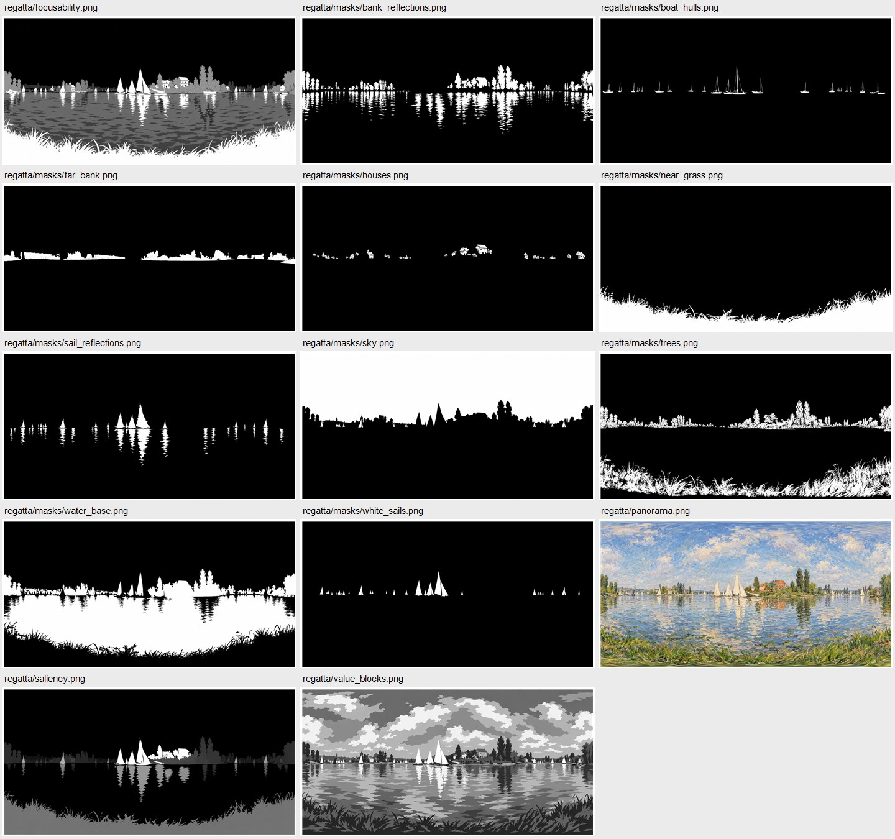
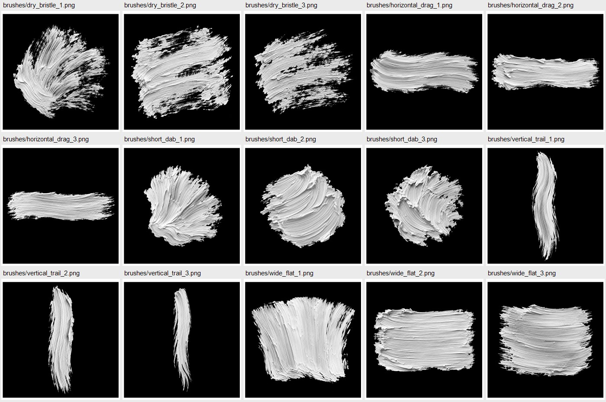
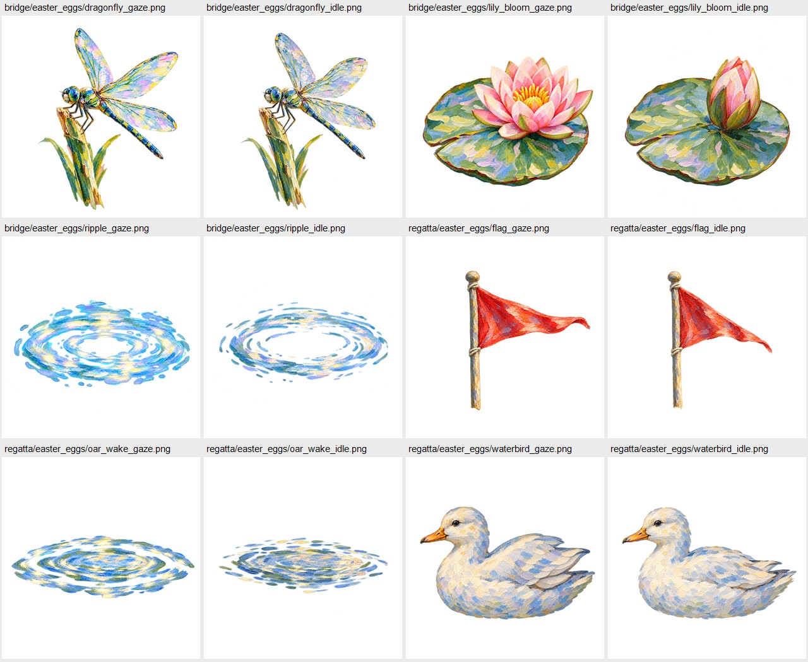

# 莫奈沉浸项目 · 生图素材包 v001

制作日期：2026-11-02 至 2026-11-03。状态：**55张生图候选稿已生成，未通过工程验收**。

## 本轮范围
全部图像资产由内置 imagegen 生图模型生成；日本桥全景沿用本轮此前生成的 v001，其余新生成。未用程序绘制素材或将小图插值放大冒充高清。文件复制、记录和打包由脚本完成。

计划包含 55 张图：
- bridge：全景1张、元素遮罩10张（含可选倒影）、主次/可聚焦/明暗稿3张、3种彩蛋各2态共6张。
- regatta：全景1张、元素遮罩10张、主次/可聚焦/明暗稿3张、3种彩蛋各2态共6张。
- brushes：短点/横拖/竖垂/宽平刷/干笔各3张，共15张。
- source：用户提供的2张全景模板，参考资料，不计入生成数量。
- docs：生成记录、提示词、实际规格、位置建议、验收状态和头显参数待填写表。

## 交付边界
- 全景实际原始输出为1774×887，低于6144×3072最低标准，不能称为已达标的高清全景。
- 2:1比例不等于已经通过等距柱状球面投影验收。左右接缝、极区、原画构图与桥角度仍需在目标查看器检查。
- 遮罩、主次图、可聚焦图均参考同一场景全景生成，但生图可能改变轮廓；同尺寸也不代表逐像素对齐。个别输出可能相差1像素，见清单。
- 主次与可聚焦灰度图可能仍带纹理或多余灰阶，作为语义与美术草稿使用；明暗稿的色阶数量也需核验。
- 笔刷为**生成的仿油画笔触**，不是实物扫描。原始输出大于512px，保留原文件，未进行后期模糊。
- 彩蛋申请真实透明背景，alpha检查结果见清单。两态来自参考编辑，未承诺像素稳定或可无跳变播放。
- 不交付分层PSD；黑白遮罩独立存放。没有将每类遮罩画成一张拼图来冒充独立文件。
- 第13项是设备资料与实测数据，无法生成。模板见 docs/headset_parameters.md。
- 尚未自动替换运行时素材，避免候选稿影响现有项目。

## 使用约定
遮罩：白=属于目标，黑=其他；窄灰边为过渡。不得作为sRGB颜色贴图参与颜色解码，应按开发引擎的线性数据纹理规范导入。
saliency.png：白=主焦点，灰=次焦点，黑=虚处。
focusability.png：白=注视时允许变清楚，黑=注视仍虚。
value_blocks.png：五档明暗概括候选稿。
彩蛋位置见 docs/easter_egg_positions.json；为**建议放置**，不是已烘焙到全景的观测坐标。

## GitHub对接
目标仓库：https://github.com/haoyuyou50-star/checklist
模板与项目分支：cursor/monet-immersive-demo-21be。
GitHub插件创建分支和Issue返回403；改用系统现有代理与Git已有认证后，推送权限检查成功。本交付通过Git同步。
交付分支：art/monet-generated-full-v001。
素材目录：monet-immersive/art_deliveries/full-v001。
压缩包：monet-immersive/art_deliveries/monet-art-full-v001.zip。
后续修改与验收记录统一更新本目录 docs/REVIEW.md 与 CHANGELOG.md；需要Issue时待插件写入权限恢复。
反馈格式：版本 / 文件 / 方位或UV / 观察问题 / 期望修改 / 验收结果。

## 快速预览

